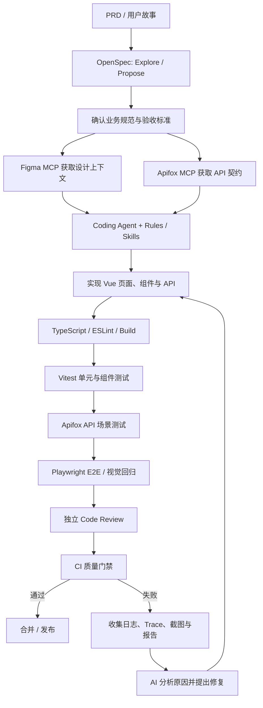
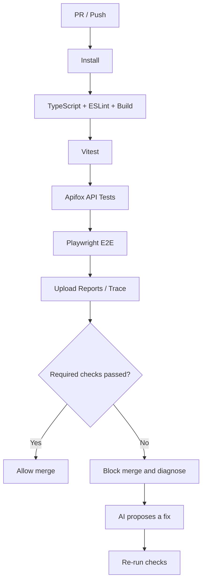

# Web 项目 AI 辅助研发与自动化测试方案

> 适用场景：Vue 3 + Vite + TypeScript 等 Web 项目，使用 Figma 设计稿、Apifox API 契约，并通过 AI Coding Agent 辅助开发。
>
> 方案定位：基于成熟工程实践与现有工具能力组合而成的参考架构，并非所有大型企业统一采用的标准工具链。具体工具可按团队现有技术栈、权限与合规要求调整。

## 1. 目标与原则

建立从需求分析到上线前验证的完整闭环：

**需求规范化 → 设计与 API 契约 → AI Coding → 自动化测试 → 独立代码审查 → CI/CD 质量门禁**

核心原则：

1. **规范是业务正确性的依据**：OpenSpec 中的需求、业务规则与验收标准应经过确认。
2. **设计和接口有明确来源**：UI 实现参考 Figma；接口实现以 Apifox 中确认过的契约为准。
3. **AI 负责提效，测试框架负责验证**：不能仅凭 AI 自我评价判断功能正确。
4. **测试结果可重复、可审查**：关键业务流程应沉淀为稳定的自动化测试。
5. **失败后先诊断再修复**：不能通过删除断言、跳过测试或放宽预期来制造“通过”。
6. **权限与环境隔离**：AI 和自动化测试优先使用测试环境、专用账号及测试数据，避免未经授权访问生产数据。

## 2. 推荐工具组合

| 环节 | 推荐工具 | 职责 |
|---|---|---|
| 需求与变更规范 | OpenSpec | 管理提案、业务规范、设计方案、任务清单与验收标准 |
| UI 设计上下文 | Figma MCP | 读取设计稿、组件、布局、设计变量等信息 |
| API 契约与接口测试 | Apifox MCP + Apifox CLI | 查询接口定义、参数、响应 Schema；执行接口测试场景 |
| AI 编码 | Cursor 或 Claude Code | 规划、实现、重构、测试辅助与代码审查 |
| 项目约束 | Rules | 固化技术栈、目录规范、编码要求和质量门禁 |
| 可复用流程 | Skills | 固化功能开发、Figma 转页面、API 集成、代码审查、测试工作流 |
| 单元/组件测试 | Vitest + Vue Test Utils | 测试工具函数、组合式函数、组件逻辑 |
| E2E 测试 | Playwright Test + Test Agents | 浏览器端到端验证、测试计划与代码生成、失败辅助修复 |
| 静态检查 | TypeScript + ESLint | 类型检查、代码规范检查 |
| 持续集成 | GitHub Actions / GitLab CI / Jenkins | 自动构建、测试、报告和合并门禁 |

### 2.1 各工具的职责边界

- **OpenSpec**：说明系统应该实现什么，不负责执行浏览器测试。
- **Figma MCP**：提供设计上下文，不保证生成代码自动达到像素级一致。
- **Apifox MCP**：让 Agent 查询接口契约；**Apifox CLI** 用于执行既有测试场景并接入 CI。
- **Rules**：规定必须遵守的约束。
- **Skills**：定义一项任务应按什么步骤执行。
- **MCP**：让 Agent 连接外部工具或数据源。
- **Playwright Test Agents**：协助规划、生成和修复测试；测试仍需有可信的验收标准。
- **CI/CD**：对检查结果执行强制门禁，避免只依赖 Agent 的自觉性。

## 3. 总体工作流



建议将开发、诊断和修复分成明确步骤，限制自动修复轮数；高风险操作或需求歧义应转交人工确认。

## 4. 推荐项目目录

以下以 Vue 3 + Vite + TypeScript 为例，可按现有仓库结构调整：

```text
web-project/
├── openspec/
│   ├── config.yaml
│   ├── specs/                         # 已生效的业务规范
│   └── changes/
│       └── add-user-management/
│           ├── proposal.md
│           ├── design.md
│           ├── tasks.md
│           └── specs/                 # 本次变更的规范增量
│
├── .cursor/
│   └── rules/
│       ├── project.mdc
│       ├── frontend.mdc
│       ├── api-contract.mdc
│       ├── figma-implementation.mdc
│       └── testing.mdc
│
├── skills/
│   ├── feature-development/
│   │   └── SKILL.md
│   ├── figma-to-vue/
│   │   └── SKILL.md
│   ├── apifox-integration/
│   │   └── SKILL.md
│   ├── code-review/
│   │   └── SKILL.md
│   └── web-testing/
│       └── SKILL.md
│
├── src/
│   ├── api/
│   ├── components/
│   ├── pages/
│   ├── router/
│   ├── stores/
│   └── utils/
│
├── tests/
│   ├── unit/
│   ├── e2e/
│   ├── fixtures/
│   └── specs/                         # Playwright 测试计划
│
├── playwright.config.ts
├── vitest.config.ts
└── .github/workflows/
    └── ci.yml
```

说明：

- `openspec/` 保存业务规范和变更产物。
- `tests/specs/` 保存供 Playwright Planner/Generator 使用的测试计划。
- `tests/e2e/` 保存正式、可重复运行的测试代码。
- 如果使用 Claude Code，可使用其对应的项目规则和 Skills 目录；如果使用 Cursor，可使用 `.cursor/rules/`。团队应避免重复维护相互冲突的规则副本。
- 不同工具的实际 Skills、MCP 配置路径可能随版本变化，落地时以对应工具的当前官方文档为准。

## 5. 阶段一：需求分析与 OpenSpec

### 输入

- PRD、用户故事或产品需求。
- 现有业务规则与代码。
- 相关页面、接口和权限约束。

### 步骤

1. 使用 OpenSpec 的探索工作流梳理需求、未知问题与影响范围。
2. 生成变更提案、规范增量、设计方案和任务清单。
3. 为用户可见的行为编写可验证的验收场景。
4. 检查正常流程、异常输入、边界条件和权限要求。
5. 由开发人员或产品负责人确认后，再进入实现阶段。

### 验收场景示例

```gherkin
Feature: 用户管理

Scenario: 查询用户
  Given 用户已登录并进入用户管理页面
  When 输入用户名 "zhangsan" 并点击查询
  Then 只展示符合查询条件的用户

Scenario: 新增用户必填字段校验
  Given 用户打开新增用户弹窗
  When 不填写用户名并提交
  Then 页面显示必填校验提示
  And 不应创建用户
```

### OpenSpec 项目规则建议

可以在 `openspec/config.yaml` 的相应产物规则中要求：

- 业务规范应描述可观察行为，并尽量使用 Given/When/Then 场景。
- UI 或用户可见行为任务应说明测试覆盖方式。
- 关键业务流程需要有 Playwright E2E 测试。
- 任务完成前必须执行其要求的测试。

规则只会指导 Agent，不等于测试已经执行。执行证据仍应来自实际测试结果与 CI。

## 6. 阶段二：Figma 设计稿转 Web 页面

### 输入

- Figma 页面或 Frame。
- 设计组件、Auto Layout、Variables 和设计 Token。
- 项目已有的 UI 组件库与主题规范。

### 工作步骤

1. 通过 Figma MCP 获取目标页面的设计上下文。
2. 让 Agent 检查项目现有组件、布局、主题、路由与样式规范。
3. 优先复用 Element Plus 和项目已有的业务组件。
4. 按页面规模拆分组件，避免把所有逻辑写进单个 Vue 文件。
5. 启动页面，对照设计稿检查尺寸、间距、字体、颜色和响应式布局。
6. 将无法从设计稿确认的交互行为列为待确认项，不擅自假设。

### Figma 转页面提示词模板

```text
请根据 Figma MCP 获取的设计稿实现当前页面。

技术约束：
- 使用 Vue 3、Vite、TypeScript 和 Element Plus。
- 先阅读现有代码、路由、公共组件和样式规范。
- 优先复用现有组件、设计 Token 和请求封装。
- 不要擅自引入新的 UI 框架。
- 避免不必要的绝对定位，保持合理的响应式布局。

执行要求：
1. 先输出页面结构与组件拆分方案。
2. 获取设计稿中的布局、变量和组件信息。
3. 按项目现有架构实现页面。
4. 对照设计稿检查视觉差异。
5. 运行 TypeScript、ESLint 和相关测试。
6. 对设计稿无法确定的交互，列出待确认问题。
```

### 实践建议

- Figma 图层和组件使用有意义的名称。
- 优先使用 Auto Layout、Variables 和可复用组件。
- 维护设计组件与代码组件的映射关系。
- 视觉对比应考虑字体加载、视口、动态数据和页面状态，不能只依赖 AI 的主观判断。

## 7. 阶段三：Apifox API 契约与前后端联调

### 职责分工

- **Apifox MCP**：查询接口 URL、HTTP 方法、参数、响应 Schema、鉴权等契约信息。
- **Apifox CLI**：运行已有 API 测试场景，并将结果接入 CI/CD。
- **Coding Agent**：按照项目请求封装生成 API 方法、类型定义和页面集成代码。

### API 集成提示词模板

```text
请通过 Apifox MCP 获取当前功能涉及的最新接口定义。

1. 确认接口 URL、HTTP 方法、鉴权方式和请求参数。
2. 检查响应结构，区分分页数据、业务状态码和错误响应。
3. 在 src/api/ 中生成符合项目现有请求封装的 API 方法。
4. 为响应结构生成 TypeScript 类型，不要无依据地猜测字段。
5. 在 Vue 页面中正确处理 loading、空数据、异常和分页。
6. 如果接口文档缺少必要信息，列出需要后端确认的内容。
7. 不要擅自修改 API 契约或访问生产环境。
```

### Mock 与真实接口策略

- 后端尚未完成：使用 Apifox Mock 或本地 Mock 支持前端开发。
- 后端完成后：切换至测试环境接口进行真实联调。
- API 测试：验证请求参数、响应结构、错误处理和业务链路。
- E2E 测试：验证用户从页面操作到业务结果的完整流程。

关键业务的测试不能全部依赖随机 Mock，否则可能出现前端测试通过但真实接口不兼容的情况。接口定义变更后，也应确认 Agent 使用的是最新契约。

## 8. 阶段四：Rules 与 Skills 设计

### Rules：项目必须遵守的约束

建议至少包含：

- `project`：技术栈、目录、命名、依赖管理和禁止事项。
- `frontend`：Vue 组件、状态管理、样式与错误处理。
- `api-contract`：接口契约来源、类型定义、鉴权与错误处理。
- `figma-implementation`：设计稿实现、组件复用和视觉验收。
- `testing`：测试要求、命令、断言和质量门禁。

### Skills：可复用的任务流程

建议建立：

1. `feature-development`：读取 OpenSpec、拆解任务、实现并验证功能。
2. `figma-to-vue`：读取设计上下文、映射组件、实现和视觉检查。
3. `apifox-integration`：查询接口契约、生成类型与 API 方法、联调。
4. `code-review`：根据规范和 Git Diff 检查代码。
5. `web-testing`：规划测试、生成测试、执行、分析失败并输出报告。

Rules 应聚焦“必须遵守什么”；Skills 应描述“这类任务按什么步骤做”。MCP 则负责让 Agent 实际访问外部工具。

## 9. 阶段五：自动化测试体系

建议使用四层测试：

| 层级 | 工具 | 主要验证内容 |
|---|---|---|
| 静态检查 | TypeScript + ESLint | 类型、规范与明显错误 |
| 单元/组件测试 | Vitest + Vue Test Utils | 工具函数、组合式函数、组件逻辑 |
| API 自动化 | Apifox CLI | API 参数、响应、接口业务链路与回归 |
| E2E 测试 | Playwright Test + Test Agents | 浏览器交互、路由、表单、权限和完整业务流程 |

### Playwright Test Agents

Playwright 官方提供的三类 Agent：

- **Planner**：探索网站并规划测试场景。
- **Generator**：根据测试计划生成 Playwright 测试代码。
- **Healer**：执行现有测试，分析失败并尝试修复。

使用前需按当前 Playwright 版本和目标 Coding Agent 的官方文档初始化，例如 Claude Code 环境：

```bash
pnpm exec playwright install
pnpm exec playwright init-agents --loop=claude
```

建议明确指定本次 OpenSpec 变更的规范路径，并要求 Planner 将每条验收场景映射到测试计划。不要假设 Planner 会自动理解仓库中所有 OpenSpec 文件。

### 建议的测试目录

```text
tests/
├── unit/
├── fixtures/
│   └── auth.ts
├── specs/
│   └── user-management.md
└── e2e/
    └── user-management.spec.ts
```

### OpenSpec 与测试的追踪关系

建议为每个重要验收场景建立映射：

| OpenSpec 验收场景 | Playwright 测试 | 状态 |
|---|---|---|
| 查询用户 | `user-management.spec.ts` 中的查询场景 | 待执行/通过/失败 |
| 新增必填校验 | `user-management.spec.ts` 中的表单校验场景 | 待执行/通过/失败 |
| 权限不足时禁止操作 | 对应权限测试 | 待执行/通过/失败 |

可以进一步在测试用例标题或标签中标注需求 ID，方便审查覆盖情况。

### 失败处理规则

测试失败后，先判断：

1. 测试定位器或测试代码错误。
2. 测试环境或测试数据异常。
3. 业务实现违反验收标准。
4. 需求本身不明确。
5. 外部服务或接口不稳定。

AI 可以辅助诊断和提出修复，但不能通过删除断言、跳过测试或擅自改变业务预期来获得通过。修复后应重新运行失败测试及相关回归测试。

## 10. 视觉回归测试

Figma 驱动的项目建议加入视觉回归，检查：

- 布局、尺寸、间距、字体和颜色是否意外变化。
- 表格、弹窗、菜单等关键组件是否发生偏移。
- 不同视口下的响应式行为是否符合要求。

Playwright 示例：

```ts
import { test, expect } from '@playwright/test';

test('用户管理页面视觉回归', async ({ page }) => {
  await page.goto('/system/user');

  await expect(page).toHaveScreenshot('user-management.png');
});
```

首次运行前需要生成并审核基线截图。测试应尽量固定视口、字体、测试数据和动画状态。基线变化需要审查，不能自动把每次新截图都当成正确结果。

## 11. 独立 Code Review

不要只让生成代码的 Agent 自己判断代码是否正确。建议安排独立审查任务，输入包括：

- OpenSpec 规范、任务清单和验收标准。
- Git Diff。
- Figma 设计约束。
- Apifox 接口契约。
- 静态检查和自动化测试结果。

审查重点：

1. 是否完整实现业务需求。
2. 是否存在接口字段猜测、异常处理遗漏或状态管理问题。
3. 是否复用了项目已有组件和请求封装。
4. 是否存在权限绕过、敏感数据泄露等风险。
5. 是否缺少必要测试或测试断言不足。

高风险操作、权限相关改动和需求歧义应由人工确认。

## 12. 阶段六：CI/CD 质量门禁

建议在 PR 或代码提交时执行：

1. 安装依赖。
2. TypeScript 类型检查。
3. ESLint。
4. 项目构建。
5. Vitest 单元与组件测试。
6. Apifox API 测试场景。
7. Playwright E2E 测试。
8. 必要的视觉回归测试。
9. 上传报告、截图、Trace 和日志。
10. 根据结果决定是否允许合并。

示例流水线：



### CI 安全要求

- 使用专用测试环境、账号和数据。
- API Token、访问密钥和密码放入 CI Secret，不要提交到仓库。
- 避免在未经授权的情况下运行生产数据修改或删除操作。
- AI 自动修复应限制次数，并保留修改记录。
- 关键测试必须通过真实的自动化结果验证，不能仅凭 AI 的文字总结放行。

## 13. 分阶段落地计划

### 阶段 A：打通单个功能

选择一个真实业务功能，完成：

- OpenSpec 规范与验收场景。
- Figma MCP 获取设计上下文。
- Apifox MCP 获取 API 契约。
- Coding Agent 实现页面与接口。
- Vitest 和 Playwright 测试。

### 阶段 B：沉淀团队规范

将成功流程沉淀为 Rules 和 Skills：

- 统一目录、组件、请求封装和错误处理。
- 统一 Figma 到代码的实现流程。
- 统一 API 契约读取和类型生成规则。
- 统一测试生成、执行、报告和失败诊断流程。

### 阶段 C：接入 CI/CD

- 自动执行静态检查、构建和测试。
- 生成测试报告与失败证据。
- 对关键检查设置必需状态。
- 让 AI 辅助分析失败，但不允许它擅自绕过质量门禁。

### 阶段 D：逐步增加 Agent 自动化

在流程稳定后，再考虑根据 Git Diff 选择测试集、自动触发测试 Agent、生成修复建议和自动创建修复分支。不建议一开始就自建多 Agent 调度平台。

## 14. 如何衡量效果

建议关注以下指标，而不是只统计 AI 生成了多少代码：

- 需求验收场景覆盖率。
- 关键业务 E2E 覆盖率。
- 自动化测试通过率与波动率。
- 缺陷逃逸率（测试未发现、上线后才暴露的缺陷）。
- AI 修复后重新通过的比例。
- 测试误报率与维护成本。
- 从需求确认到可合并 PR 的周期。

覆盖率指标必须有明确分母和统计口径；测试数量多不代表测试有效。

## 15. 最终推荐

对于 Vue 3 / Vite Web 项目，推荐从以下组合开始：

- **需求与验收：** OpenSpec
- **设计上下文：** Figma MCP
- **API 契约与接口测试：** Apifox MCP + Apifox CLI
- **AI 编码：** Cursor 或 Claude Code
- **工作流固化：** Rules + Skills
- **自动化测试：** Vitest + Playwright Test Agents + Apifox API 测试
- **质量门禁：** TypeScript + ESLint + CI/CD
- **质量保障：** 独立 Code Review、可追踪验收场景、受控 AI 修复

这是一套基于成熟工具能力组合出的参考架构，不应被理解为所有大型企业统一使用的标准方案。落地时应以团队已有平台、工具官方文档、安全策略和实际项目复杂度为准。

**核心思想：AI 提高开发与测试效率；OpenSpec 定义业务正确性；Figma 和 Apifox 提供设计与接口依据；自动化测试提供可重复验证；CI/CD 强制执行质量标准。**
