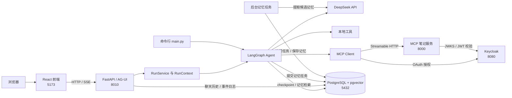
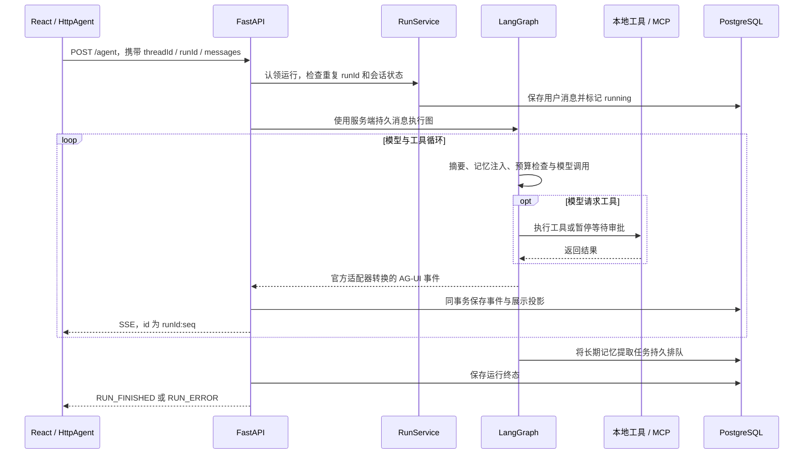
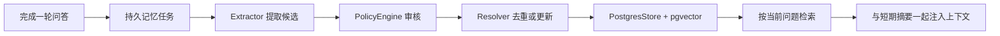

# 项目架构与目录说明

> 基于 2026-11-03 当前工作区源码整理。本文介绍已经实现的结构与行为；后续生产化计划见 [生产化重构方案](docs/agent-production-plan.md)。

## 1. 项目定位

这是一个具备网页和命令行入口的学习助手项目，围绕 LangGraph 实现模型推理、工具调用、人工确认、会话恢复和记忆管理。

核心能力包括：

- 使用 DeepSeek 生成回答，支持工具调用及思考内容的协议转换。
- 调用本地计算、时间和演示天气工具。
- 通过 MCP 管理当前登录用户的学习笔记。
- 用 AG-UI/SSE 向页面流式发送文本、工具、步骤和审批事件。
- 保存聊天历史、图执行 checkpoint、长期记忆及运行事件。
- 支持取消、继续生成、会话删除和事件重放。
- 对可恢复的调用失败实施有限重试，并受运行预算约束。

当前采用模块化单体：Agent 的运行、协议适配、记忆和持久化位于一个 Python 服务中；MCP 工具服务独立部署。没有独立的 Redis、消息队列或任务 worker 服务，长期记忆 worker 运行在 Agent 进程的后台线程中。

## 2. 整体架构



### 2.1 前端 `front`

使用 React、TypeScript 和 Vite，负责会话列表、消息展示、工具卡片、审批交互以及取消和继续按钮。

页面通过 `@ag-ui/client` 的 `HttpAgent` 调用 Agent 服务，不直接访问 DeepSeek、PostgreSQL 或 MCP 服务。

### 2.2 Agent 服务 `agent-server`

使用 FastAPI 提供 HTTP/SSE 接口，通过 LangChain `create_agent` 构建 LangGraph 图。

它负责加载模型和工具、管理运行状态、执行图、处理审批、维护记忆，并将执行过程转换为前端事件。

同一份执行核心也供 `main.py` 命令行入口使用，命令行无需经过 FastAPI。

### 2.3 MCP 服务 `mcp-server`

提供学习笔记的 tools、resources 和 prompts，并校验 Keycloak 签发的访问令牌。

笔记按用户隔离，但目前存放于 MCP 进程内存中。笔记尚未写入 Agent 的 PostgreSQL，重启 MCP 服务会恢复为种子笔记。

### 2.4 Keycloak `keycloak`

提供 OAuth 登录、令牌签发和角色配置。笔记服务将角色映射为 `notes:read`、`notes:write` 权限。

这里的登录目前用于 Agent 到 MCP 的访问，不等于前端已经具备独立用户认证。

### 2.5 PostgreSQL 与 pgvector

由 `agent-server/docker-compose.yml` 启动，保存图 checkpoint、展示历史、事件日志、长期记忆、记忆任务及迁移版本。

pgvector 用于长期记忆的语义检索，模型对话仍通过 DeepSeek API 完成。

## 3. 根目录结构

以下省略 `.git`、`.venv`、`node_modules`、`dist`、缓存以及锁文件内部内容。

```text
AI Study/
├── README.md                       # 本机环境准备与服务启动说明
├── 项目架构与目录说明.md            # 本文：整体架构、目录职责、数据与调用链
├── docs/
│   └── agent-production-plan.md     # 生产化重构设计、实施记录和后续阶段
├── .github/
│   └── workflows/ci.yml            # 后端测试/静态检查与前端构建
├── .vscode/
│   └── settings.json               # 工作区 Python 解释器等编辑器配置
├── agent-server/                   # Agent 后端与命令行程序
├── mcp-server/                     # 独立 MCP 学习笔记服务
├── front/                          # React 聊天页面
├── keycloak/                       # 登录服务与 realm 导入配置
├── 2026…学习路线…md                # 学习路线文档，不参与服务运行
└── web项目AI辅助研发与自动化测试方案.md # 研发与测试方案文档
```

`agent-server` 原名为 `agent-demo`。目录和 Python 项目名称已经更改，但以下标识有意保留：

- Keycloak 已注册的 OAuth client ID：`agent-demo`。
- 数据库 Compose 项目名称：`agent-demo`，用于继续使用原来的数据卷。

这些兼容标识独立于代码目录名，不应仅为统一名称而直接替换。

## 4. Agent 后端目录职责

```text
agent-server/
├── main.py                         # 命令行入口、参数解析、交互聊天和用量输出
├── pyproject.toml                  # Python 依赖、开发依赖和 Ruff 配置
├── uv.lock                         # Python 依赖锁文件
├── .env.example                    # 模型、数据库、协议与重试配置示例
├── .env                            # 本机配置及密钥；被 Git 忽略
├── docker-compose.yml              # PostgreSQL + pgvector 与持久数据卷
├── README.md                       # Agent 使用说明和实现边界
├── agent/
│   ├── __init__.py                 # 对外导出 Agent、AgentLimits、AgentResult，延迟加载
│   ├── server.py                   # FastAPI 路由、应用生命周期、SSE 和 worker 管理
│   ├── loop.py                     # 一轮执行、checkpoint 恢复、审批和文本续写
│   ├── graph.py                    # 模型构造、图编译、预算中间件和写工具审批策略
│   ├── errors.py                   # 统一错误码、安全提示和公共错误结构
│   ├── tools.py                    # 工具注册、参数 Schema、执行包装和只读重试
│   ├── limits.py                   # 调用次数、token、费用估算、超时与重试计数
│   ├── cancellation.py             # 活动运行注册、协作式取消与模型回调
│   ├── continuation.py             # 未完成回答的数据结构和续写提示
│   ├── history.py                  # 展示历史、事件投影、事件日志和中断恢复
│   ├── mcp_client.py               # MCP 连接、工具桥接、资源/模板读取及确认回调
│   ├── mcp_auth.py                 # OAuth 本机回调、令牌存储和认证 HTTP 客户端
│   ├── Untitled                    # 草稿内容，不是服务启动入口
│   ├── application/
│   │   ├── __init__.py
│   │   └── runs.py                 # RunService：认领、执行、释放一次运行
│   ├── api/
│   │   ├── __init__.py
│   │   └── errors.py               # HTTP 错误处理、请求参考号与安全响应
│   ├── runtime/
│   │   ├── __init__.py
│   │   ├── context.py              # RunContext、ContextVar 隔离和辅助模型调用
│   │   ├── retry.py                # 统一同步/异步重试、错误分类、退避与期限控制
│   │   └── models.py               # 为真实 SDK 客户端配置超时并关闭内部重试
│   ├── adapters/
│   │   ├── __init__.py
│   │   └── agui/
│   │       ├── __init__.py         # 官方 LangGraphAgent 的薄适配与事件过滤
│   │       ├── messages.py         # AG-UI 输入消息和审批数据转换
│   │       ├── display.py          # 业务卡片、MCP 确认和续写展示事件
│   │       ├── errors.py           # 结构化错误到 AG-UI RUN_ERROR 的转换
│   │       └── streaming.py        # 有界 SSE 订阅队列及慢消费者处理
│   ├── memory/
│   │   ├── __init__.py             # 记忆模块导出，采用延迟加载
│   │   ├── types.py                # Candidate、Review、MemoryRecord 数据结构
│   │   ├── short_term.py           # 会话状态、短期摘要压缩及 PostgreSQL saver
│   │   ├── long_term.py            # 长期记忆仓储、保存/查询和嵌入模型配置校验
│   │   ├── extractor.py            # 用模型从一轮问答中提取候选记忆
│   │   ├── policy.py               # 候选类型、长度、敏感内容与置信度审核
│   │   ├── resolver.py             # 相同主题更新、重复内容跳过、新记忆新增
│   │   ├── context_builder.py      # 检索相关记忆，与摘要一起注入模型上下文
│   │   ├── embed.py                # 嵌入模型、revision、设备和归一化配置
│   │   ├── postgres.py             # 数据库地址、连接池与连接错误处理
│   │   └── jobs.py                 # 持久记忆任务、租约、后台 worker 和重试
│   └── persistence/
│       ├── __init__.py
│       ├── checkpoints.py          # 将同步 PostgreSQL saver 的 I/O 异步卸载
│       ├── migrate.py              # 版本化、事务化的应用数据库迁移
│       └── migrations/
│           ├── 001_memory_jobs.sql # 记忆任务与嵌入模型配置表
│           ├── 002_run_events.sql  # 会话展示历史与运行事件表
│           └── 003_error_info.sql  # 后台任务结构化错误详情
└── tests/                          # 确定性模型、故障注入和 PostgreSQL 集成测试
```

### 4.1 后端分层关系

- **接口层**：`server.py` 负责 HTTP 输入、状态码、服务生命周期和 SSE 连接。
- **应用层**：`application/runs.py` 组织运行的认领、执行与资源释放，不依赖 AG-UI 事件结构。
- **执行层**：`loop.py`、`graph.py`、`runtime/` 处理图执行、恢复、预算和取消。
- **协议适配层**：`adapters/agui/` 连接执行结果与 AG-UI 协议，保留业务展示扩展。
- **工具集成层**：`tools.py`、`mcp_client.py`、`mcp_auth.py` 连接本地函数和外部 MCP 服务。
- **记忆与存储层**：`memory/`、`history.py`、`persistence/` 分别负责记忆策略、展示历史和数据库实现。

这是当前的职责划分；`loop.py` 和 `server.py` 仍保留部分编排逻辑，并非全部模块都已拆成独立服务。

## 5. 前端目录职责

```text
front/
├── package.json                    # 前端依赖与 dev/build/preview 命令
├── pnpm-lock.yaml                  # 前端依赖锁文件
├── vite.config.ts                  # Vite、开发监听地址和 /agent 代理
├── tsconfig.json                   # TypeScript 配置
├── index.html                      # 页面 HTML 入口
└── src/
    ├── main.tsx                    # React 挂载入口
    ├── App.tsx                     # 会话区、消息区、输入区的顶层组装与状态协调
    ├── App.css                     # 主布局样式
    ├── styles.css                  # 全局样式
    ├── vite-env.d.ts               # Vite 环境类型声明
    ├── components/
    │   ├── ChatTranscript.tsx      # 消息、工具结果、思考内容、卡片和确认 UI
    │   ├── ChatTranscript.css
    │   ├── ConversationHistory.tsx # 会话列表、新建、切换和删除操作
    │   └── ConversationHistory.css
    ├── hooks/
    │   ├── useAgentChat.ts         # HttpAgent、流式事件消费、发送、审批、取消和继续
    │   └── useConversations.ts     # 会话加载、切换、删除及当前会话选择
    ├── lib/
    │   ├── errors.ts               # 错误结构解析、HTTP 传递与安全展示
    │   └── conversationApi.ts      # Agent 地址、历史 API 请求与 GET 重试
    └── types/
        └── chat.ts                 # 展示条目、会话详情、工具与审批的数据类型
```

前端默认请求绝对地址 `http://127.0.0.1:8010/agent`，由后端 CORS 配置允许开发页面访问。Vite 同时配置了 `/agent` 代理；设置 `VITE_AGENT_URL=/agent` 时可走相对地址代理。

当前页面刷新或恢复仍以会话详情快照及运行中轮询为主，尚未自动接入后端的事件游标重放接口。

## 6. MCP 与身份服务目录职责

```text
mcp-server/
├── pyproject.toml                  # MCP SDK、JWT 校验依赖与命令入口
├── uv.lock
├── README.md
└── src/mcp_server/
    ├── __init__.py
    ├── __main__.py                 # python -m mcp_server 的入口
    ├── server.py                   # 笔记数据、tools、resources、prompts 和权限检查
    └── auth.py                     # JWT 签名、issuer、audience、有效期和角色校验

keycloak/
├── docker-compose.yml             # 本机 Keycloak 开发容器
└── study-realm.json                # study realm、OAuth 客户端及用户/角色配置
```

MCP 提供的能力包括：

- **Tools**：`add_note` 新增、`delete_note` 删除、`search_notes` 搜索。
- **Resources**：`notes://catalog` 目录、`notes://{note_id}` 单条笔记。
- **Prompts**：`summarize_notes` 总结笔记、`quiz_from_notes` 基于笔记出题。

`search_notes` 明确标记为只读；新增和删除标记为非只读。Agent 将远端 tools 转换为 LangChain 工具，并将 resource/prompt 读取包装为 `read_mcp_resource`、`get_mcp_prompt` 两个桥接工具。

## 7. 一次网页请求的执行链路



执行中的几个重要约定：

1. `thread_id` 标识会话和 checkpoint，`run_id` 标识一次运行；同一请求的 `run_id` 不可重复执行。
2. 服务端持久消息是请求执行的依据，浏览器不能覆盖已经保存的历史或续写前缀。
3. 模型返回 `tool_calls` 时进入工具执行，再将结果交回模型，直到生成回答、等待审批、取消或达到限制。
4. 标准文本、工具和步骤事件主要由官方 `ag-ui-langgraph` 转换；业务卡片、MCP 确认及文本续写由薄适配层扩展。
5. 应用层统一控制运行的开始和结束事件，避免官方适配器与应用重复发送终态。
6. 原始图 state、压缩后的消息快照和内部摘要不会直接覆盖完整展示历史。

## 8. 聊天历史、短期记忆与长期记忆

这三者有不同用途，应分别理解。

### 8.1 聊天展示历史

实现位置：[history.py](agent-server/agent/history.py)。

- 保存用户在页面看到的消息、工具结果、卡片、确认状态和运行状态。
- 通过 `chat_conversations` 中的 JSONB 文档持久化。
- 模型上下文压缩后，页面完整历史仍可保留。
- 同一事务中追加运行事件并更新展示投影，避免页面收到尚未提交的数据。

### 8.2 短期记忆：当前会话的执行上下文

实现位置：[short_term.py](agent-server/agent/memory/short_term.py)。

- 图的消息与状态通过 PostgreSQL checkpoint 按 `thread_id` 保存。
- 每次调用模型前检查是否需要压缩旧消息。
- 默认阈值 `max_tokens=1600`，当前实现使用渲染文本字符数作保守估算，并非精确 tokenizer 计数。
- 以保留最近 4 条消息为目标，再将分割位置调整到用户消息边界，避免拆开工具调用与结果。
- 旧消息结合已有摘要分块总结，摘要写入 `state.summary`，对应旧消息从图状态移除。
- 摘要提示要求保留用户身份、偏好、决定和未完成事项，目标不超过 200 字。

如果无法安全分割，或摘要为空，则不会执行该次消息删除。

### 8.3 长期记忆：跨会话保存的用户信息



录入规则依次实现于：

1. [loop.py](agent-server/agent/loop.py) 的 `_remember()`：读取本轮问答；空内容或停止说明跳过，否则按运行 ID 提交后台任务。
2. [extractor.py](agent-server/agent/memory/extractor.py)：让模型提取稳定事实、用户偏好及明确要求记住的事项，排除天气、时间、一次性计算、报错和寒暄。
3. [policy.py](agent-server/agent/memory/policy.py)：审核 `fact/preference/episode` 类型，拒绝空内容、命中敏感内容规则或超过 200 字的候选；置信度阈值默认 `0.6`，`episode` 分数乘以 `0.9`。
4. [resolver.py](agent-server/agent/memory/resolver.py)：相同主题内容不变则跳过，变化则更新；其他内容再检查重复，否则新增。
5. [long_term.py](agent-server/agent/memory/long_term.py)：按 `("study", user_id)` 命名空间保存，使用确定性 key 减少重复写入。

后台任务由 [jobs.py](agent-server/agent/memory/jobs.py) 的 `MemoryWorker` 处理：

- PostgreSQL 保存任务、尝试次数、下次可执行时间和租约。
- 使用 `FOR UPDATE SKIP LOCKED` 认领任务，租约默认 5 分钟。
- 每次任务使用独立 30 秒、8000 token 估算上限及费用预算。
- 只对临时错误重试，最多执行 3 次；认证、参数和预算错误立即终止。
- 提取完成后还需确认租约归属，再审核和写入记忆。

长期记忆属于最终一致性：回答可以先完成，下一轮不保证立即读到刚提交的记忆。

### 8.4 记忆检索与注入

实现位置：[context_builder.py](agent-server/agent/memory/context_builder.py)。

- 使用最新用户问题检索相关记忆，默认最多注入 4 条，相似度门槛为 `0.5`。
- 会话摘要与长期记忆共享默认 500 token 的估算注入预算，先给摘要分配空间，再给检索结果分配剩余空间。
- 注入时明确标注这些内容是历史资料，不应作为新的系统指令执行。
- 嵌入模型默认是本机中文模型 `huggingface:BAAI/bge-small-zh-v1.5`；可固定 revision。
- 模型名称、revision 或维度与登记配置不一致时拒绝初始化，不会在启动时自动删向量表。

## 9. 数据存储职责

数据库内容分为应用自建表和 LangGraph 管理的表：

- `chat_conversations`：会话归属、标题、展示文档及当前运行状态。
- `agent_run_events`：每次运行按序号保存的 AG-UI 事件，用于重放。
- `agent_memory_jobs`：后台记忆提取任务、重试、租约、错误分类和用量。
- `agent_embedding_config`：嵌入模型标识与维度登记。
- `agent_schema_migrations`：应用 SQL 迁移的执行版本。
- `checkpoints`、`checkpoint_blobs`、`checkpoint_writes` 等：LangGraph 执行状态及恢复数据。
- `store`、`store_vectors` 等：LangGraph Store 的长期记忆及向量索引。

应用表由 `persistence/migrations/` 管理；checkpoint 和 store 的基础 schema 由对应库的 `setup()` 管理。不要直接修改库管理的内部 schema。

会话删除会在事务中清理展示历史和对应 checkpoint，事件通过外键级联删除。用户级长期记忆与 MCP 笔记不随会话删除；记忆任务也没有绑定会话外键。

## 10. 审批、取消与恢复

### 10.1 两种确认通道

- **新增笔记**：`graph.py` 使用 `HumanInTheLoopMiddleware`，在 `add_note` 执行前暂停图；前端通过 AG-UI `resume[]` 返回审批决定。
- **删除笔记**：MCP server 在工具协议交互中发起 elicitation；页面通过 `POST /agent/elicit` 返回接受或拒绝，原工具调用再继续。

图审批有 checkpoint 支撑；MCP elicitation 的等待仍依赖进程内 Future，不能认为二者都具有完整的跨进程恢复能力。

### 10.2 取消

- 前端通过会话取消接口提交当前 `runId`。
- `RunRegistry` 定位运行，设置取消信号。
- 模型回调、模型/工具边界、重试等待及 MCP 等待检查取消信号。
- 保留已显示的回答前缀，并保存取消后的状态。

取消是协作式停止，不承诺撤回已经完成的远端写操作。普通同步 Python 函数也无法安全地被强制终止。

### 10.3 继续生成与恢复执行

- 纯文本中断：基于已有回答前缀请求后续文本，继续使用同一个逻辑回答 ID。
- 图任务中断：从 checkpoint 中恢复待执行任务。
- 开始新问题：处理并放弃上轮未完成的调用，避免直接沿用旧的取消任务。
- 服务重启：把遗留运行标记为 `interrupted`，保留部分回答并追加可重放终态事件。

文本续写和图恢复是不同路径，相关逻辑主要位于 `loop.py`、`continuation.py` 和 `history.py`。

## 11. 统一重试与预算

实现位置：[retry.py](agent-server/agent/runtime/retry.py)、[models.py](agent-server/agent/runtime/models.py)、[limits.py](agent-server/agent/limits.py)。

- 模型、明确只读的工具和 MCP 读取默认最多尝试 3 次，包含第一次请求。
- 只对连接错误、网络超时及指定临时 HTTP 状态重试；参数、认证、权限和证书错误不重试。
- 退避时间按指数增长并加入抖动；`Retry-After` 优先，若等待超出剩余期限则结束。
- 模型产生流式 chunk 后，包括思考或工具参数，失败时不自动从头调用模型。
- SDK 真实同步/异步客户端的内部重试被关闭，避免多层重试叠加。
- 写工具不做故障自动重放；结果未知时阻止同一运行内再次提交相同工具和参数。
- 长期记忆只由任务队列负责重试，每次任务执行的模型请求只尝试一次。

所有重试继续使用原来的运行预算，不重新获得一份超时或调用次数。默认运行限制包括模型调用 8 次、工具调用 12 次、60 秒、20000 token 及 0.05 美元估算费用。费用和部分 token 计数是控制用途的估算，不是账单。

MCP 启动连接有有限网络重试，运行中永久断开的会话目前不会自动重建。

## 12. HTTP 接口概览

接口均定义在 [server.py](agent-server/agent/server.py)：

- `GET /health`：HTTP 服务、Agent 初始化及 MCP 连接状态。
- `POST /agent`：提交运行，返回 AG-UI SSE。
- `GET /agent/mcp/status`：读取 MCP 状态。
- `POST /agent/elicit`：回复 MCP 发起的确认。
- `GET /agent/conversations`：读取会话列表。
- `POST /agent/conversations`：创建会话。
- `GET /agent/conversations/{thread_id}`：读取完整展示快照和当前状态。
- `DELETE /agent/conversations/{thread_id}`：删除会话及相关 checkpoint。
- `POST /agent/conversations/{thread_id}/cancel`：请求取消指定运行。
- `GET /agent/conversations/{thread_id}/runs/{run_id}/events`：补发并跟随已持久化事件。

SSE 事件 ID 格式为 `runId:seq`；重放接口接受 `after` 参数或 `Last-Event-ID` 请求头。

`/health` 返回 HTTP 存活不代表模型和 MCP 都已就绪，应同时查看嵌套的 `agent.status` 和 `mcp.status`。

## 13. 身份、权限与部署边界

当前身份分为两部分：

- 聊天历史归属：来自 `AGENT_HISTORY_OWNER`，默认 `local`，同一部署的浏览器共享这一应用身份。
- 笔记与长期记忆归属：使用 Agent 的 MCP 登录用户；MCP 服务验证令牌并根据角色限制读写。

因此，当前部署仍是单应用身份、单 MCP 登录会话模式。虽然 RunContext 已隔离运行可变状态，入场控制仍限制整个 Agent 服务同时执行一轮，冲突请求返回 409，部署应保持单 HTTP worker。

尚未实现的能力包括：

- 浏览器 JWT 认证与端到端多租户身份统一。
- 按用户委托和隔离的 MCP 会话。
- 运行级数据库租约、多实例接管和完整持久审批。
- 远端写操作的跨运行幂等与结果查询。
- 消息分行存储、事件保留期及高吞吐批量投影。

这些限制与后续方向详见 [生产化方案](docs/agent-production-plan.md)。

## 14. 配置与本机启动关系

常用配置来自 `agent-server/.env` 或进程环境变量，`agent-server/.env.example` 提供主要配置示例：

- `DEEPSEEK_API_KEY`、`DEEPSEEK_MODEL`、`DEEPSEEK_BASE_URL`：模型访问。
- `MEMORY_DATABASE_URL`：数据库连接。
- `EMBEDDING_MODEL`、`EMBEDDING_REVISION`：嵌入模型。
- `MCP_URL`、`MCP_ENABLED`：MCP 服务地址与是否启用。
- `AGUI_ADAPTER`：默认 `langgraph`，可临时切回 `legacy`。
- `MODEL_MAX_ATTEMPTS`、`MCP_READ_MAX_ATTEMPTS`、`TOOL_READ_MAX_ATTEMPTS`、`MCP_CONNECT_MAX_ATTEMPTS`：总尝试次数。
- `RETRY_BASE_DELAY`、`RETRY_MAX_DELAY`、`RETRY_ATTEMPT_TIMEOUT`、`MODEL_ATTEMPT_TIMEOUT`：退避与尝试超时。

`AGENT_HOST`、`AGENT_PORT`、`AGENT_HISTORY_OWNER` 可通过服务环境配置；前端使用 `VITE_AGENT_URL`。Keycloak/MCP 的 issuer、resource URL 与 OAuth client 配置需要彼此匹配。

网页完整链路需要：Keycloak、PostgreSQL、MCP、Agent、前端。先启动两项基础设施，再启动 MCP、Agent 和前端。HTTP 入口会在后台初始化模型和连接 MCP，期间会话历史可先可用；CLI 初始化路径则会等待所需依赖。

具体命令见 [根 README](README.md) 和 [Agent README](agent-server/README.md)。前端依赖使用 pnpm，两个 Python 子项目分别使用 uv 管理，不是在根目录统一执行一次依赖安装。

## 15. 测试与 CI

后端测试目录中：

- `test_history.py`：历史 API、审批状态、取消/继续、启动降级与重启恢复。
- `test_cancellation.py`：真实图 checkpoint 下的协作取消与工具恢复。
- `test_protocol.py`：官方 AG-UI 适配、reasoning、工具、内部摘要过滤和续写。
- `test_reliability.py`：长消息、并行预算、运行上下文、MCP 超时及慢消费者。
- `test_persistence.py`：事件与投影事务、重放、记忆任务、租约和 PostgreSQL checkpoint。
- `test_retry.py`：错误分类、重试次数、Retry-After、取消及真实 SDK 的 MockTransport 请求次数。
- `test_model_retry.py`：通过真实 LangGraph 验证模型重试、思考模式回退及部分流保护。

持久任务测试使用独立随机 schema，避免开发服务的 worker 领取测试任务。主要故障测试使用确定性模型和 HTTP mock。

`.github/workflows/ci.yml` 在独立 PostgreSQL 容器中执行后端静态检查与回归测试，并独立执行前端类型检查和生产构建。

## 16. 修改需求时从哪里入手

- 修改 Agent 人设和系统提示：`agent-server/agent/loop.py` 的 `SYSTEM_PROMPT`。
- 修改模型、模型兼容和图中间件：`agent-server/agent/graph.py`。
- 新增本地工具：`agent-server/agent/tools.py`，明确标注是否只读。
- 新增远端笔记能力：`mcp-server/src/mcp_server/server.py`。
- 修改长期记忆提取内容：`memory/extractor.py` 的提示词。
- 修改长期记忆录入门槛：`memory/policy.py`。
- 修改记忆更新和去重：`memory/resolver.py`。
- 修改短期压缩阈值和摘要规则：`memory/short_term.py`。
- 修改记忆检索和注入量：`memory/context_builder.py`。
- 修改重试分类和退避：`runtime/retry.py`。
- 修改聊天事件展示：后端 `adapters/agui/display.py`，前端 `useAgentChat.ts` 与 `ChatTranscript.tsx`。
- 新增应用数据库表或字段：新增 `persistence/migrations/` SQL 文件，不改已经执行的迁移文件。
- 调整登录角色与笔记权限：`keycloak/study-realm.json` 和 `mcp-server/src/mcp_server/auth.py`。
